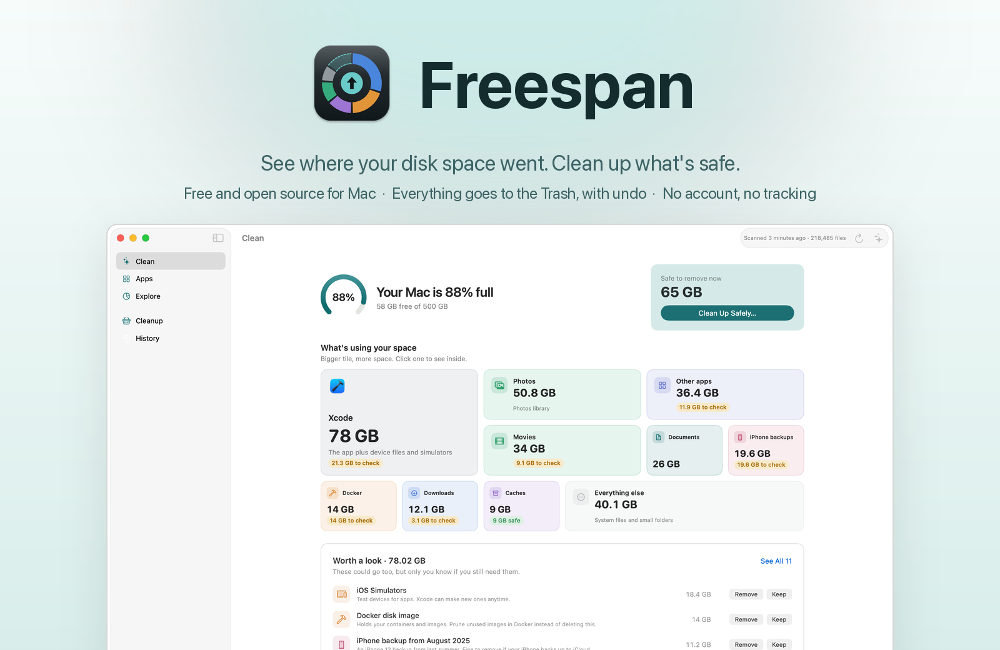
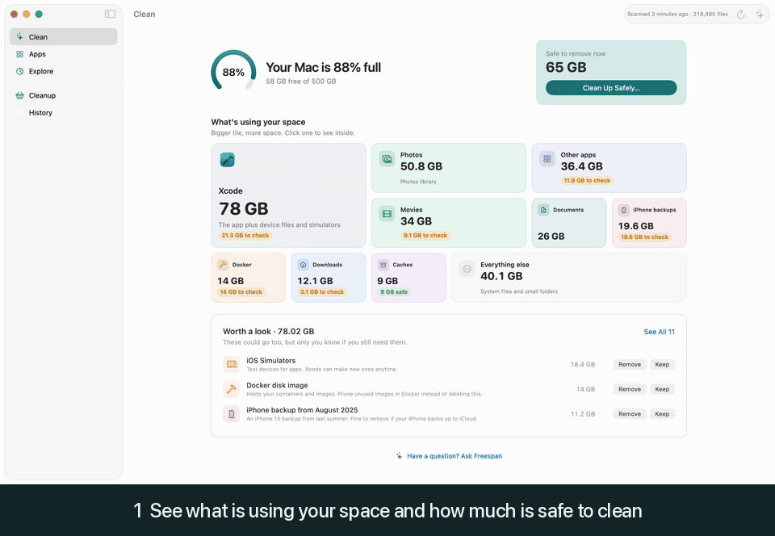
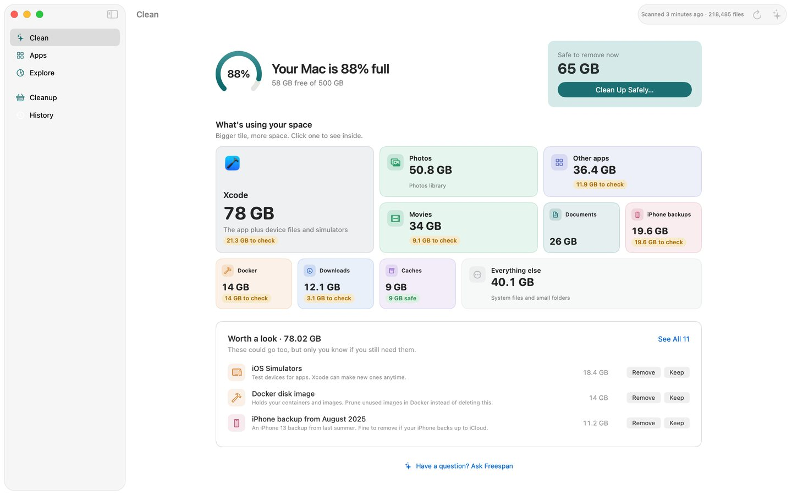
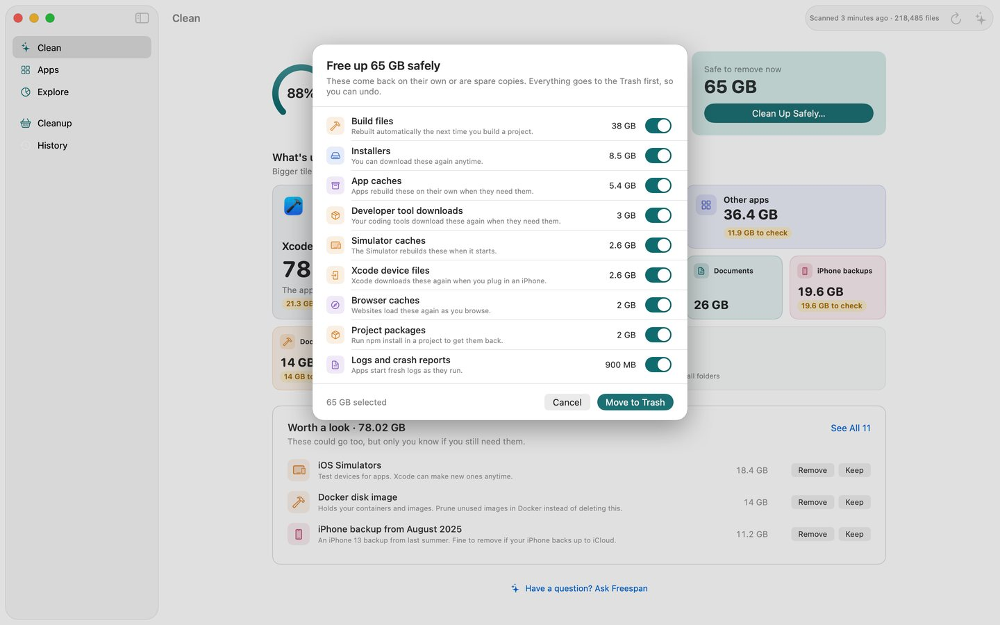
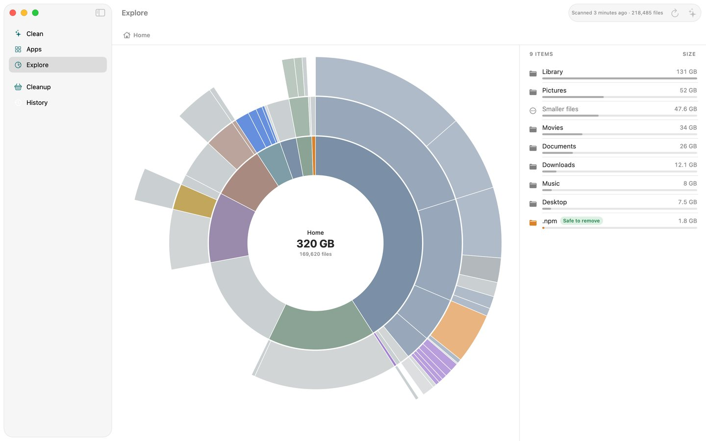
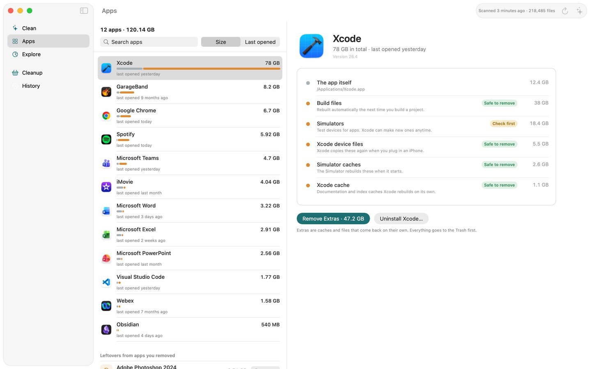
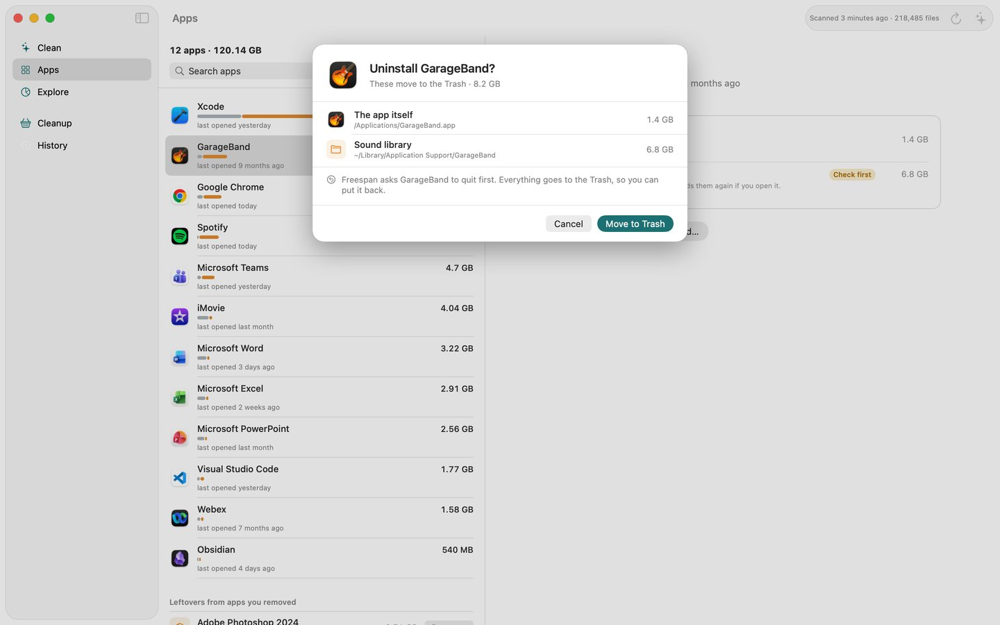
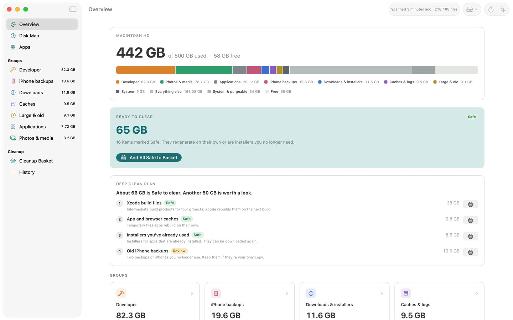
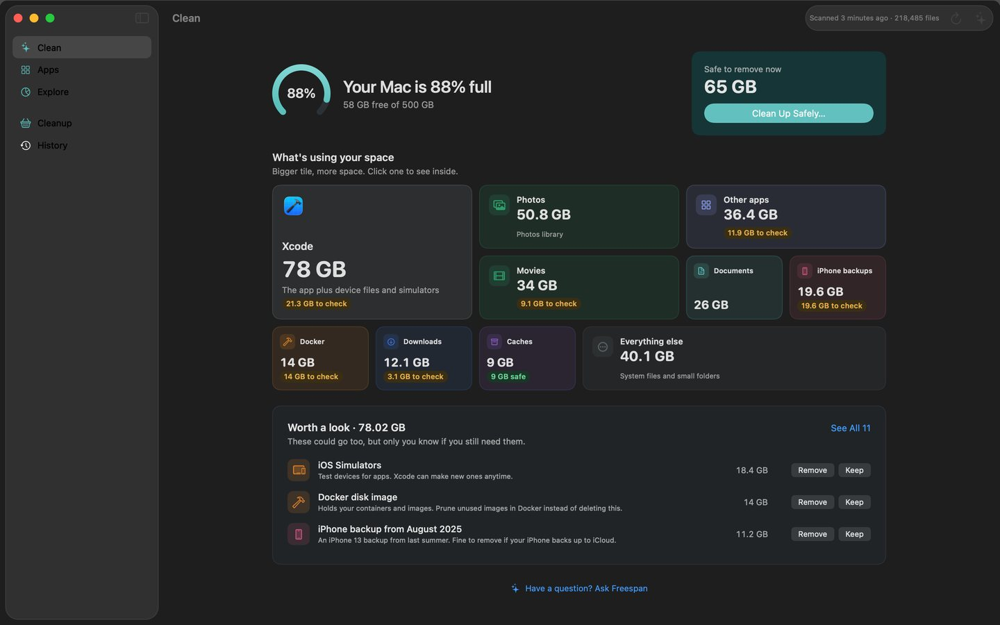

<p align="center">
  <a href="https://mcconnelldigital.com/freespan/">
    <picture>
      <source media="(prefers-color-scheme: dark)" srcset="docs/images/hero-dark.png">
      
    </picture>
  </a>
</p>

<p align="center">
  <a href="https://mcconnelldigital.com/freespan/"><b>Download Freespan</b></a>
  &nbsp;·&nbsp;
  <a href="#build-from-source">Build from source</a>
  &nbsp;·&nbsp;
  <a href="#faq">FAQ</a>
</p>

<p align="center">
  
  
  <a href="LICENSE"></a>
  
</p>

Freespan is a free, open-source Mac app that shows where your disk space went, explains what each item is in plain words, and cleans up what is safe to remove.

**[Download Freespan for Mac](https://mcconnelldigital.com/freespan/)** (a notarized DMG, about 5 MB, from the project's download page).

<p align="center">
  
</p>

## What it does

- **Scans your home folder** (Easy mode) **or the whole disk** (Advanced mode) and shows real sizes. Sizes count the space files actually take up on disk, and a file with several hard links is counted once. Your last scan is cached, so the app opens with results already on screen.
- **Tells you what is safe to clean.** More than 80 built-in rules recognize common space users: Xcode build files, device support files and simulators, package manager caches (npm, Homebrew, CocoaPods, pip, Cargo, Gradle and others), `node_modules`, Docker disk images, browser and app caches, local AI models, old installers, iPhone backups, and large old files.
- **Labels every item** as *Safe to remove* (it comes back on its own), *Check first*, or *Keep*. Items your Mac or your apps need are not offered for removal.
- **Names before paths.** Items no rule covers are identified on your Mac from app IDs, a table of known locations, Spotlight metadata and file types, so you see "Slack's cache" and not just a folder name.
- **Cleans up in one step.** *Clean Up Safely* lists what it will move, with a switch for each group and a running total.
- **Explore** is an interactive ring chart of your folders. Click a slice to drill in. Quick Look and Reveal in Finder work on any item.
- **Apps** lists installed apps with the data each one keeps elsewhere. You can clear an app's extras (caches and files that come back on their own), uninstall an app together with its data, or find data left behind by apps you already removed.
- **History with Undo** for everything Freespan has moved.
- **Skips what is in use.** If a running app has an item open, Freespan leaves it alone and offers to quit the app (apps you can quit, never background services). A folder that is only partly in use is cleaned partly.

## What it never does

- **It never deletes anything permanently.** Cleanup uses the system's Move to Trash. Every move is written to an undo log (`~/Library/Application Support/Freespan/actions.json`), and History can put items back. You get the space back when you empty the Trash, which Freespan does not do for you.
- **It never lets a guess count as safe.** Only the built-in rules can label something *Safe to remove*. A label from local identification or from any AI assistant stops at *Check first*, and is never included in *Clean Up Safely*.
- **It never touches protected locations.** A fixed list can't be moved whatever a rule or assistant says. It includes your Keychains, Mail, Messages, Safari data, Calendars and Reminders, iCloud Drive, Photos and Music libraries, most dot-folders in your home folder (such as `.ssh`), the folders `Desktop`, `Documents`, `Downloads`, `Pictures`, `Music` and `Movies` themselves (items inside can still be cleaned), Safari.app, and everything outside your home folder and `/Applications`. The list is in [`ProtectedPaths.swift`](FreespanKit/Sources/FreespanKit/Rules/ProtectedPaths.swift).
- **It has no account, no analytics and no update check.** See [Privacy](#privacy).

## Screenshots

The images below were rendered from sample data, so they show no real files.

<table>
  <tr>
    <td width="50%"><a href="docs/images/clean.jpg"></a><br><sub><b>Clean.</b> How full your Mac is, how much is safe to remove, and what is using the space.</sub></td>
    <td width="50%"><a href="docs/images/cleanup-sheet.jpg"></a><br><sub><b>Review before anything moves.</b> A switch for each group, a total, and Move to Trash.</sub></td>
  </tr>
  <tr>
    <td width="50%"><a href="docs/images/explore.jpg"></a><br><sub><b>Explore.</b> A ring chart of every folder, with the biggest first in the list beside it.</sub></td>
    <td width="50%"><a href="docs/images/apps.jpg"></a><br><sub><b>Apps.</b> Each app with the caches and support files it keeps, plus Remove Extras and Uninstall.</sub></td>
  </tr>
  <tr>
    <td width="50%"><a href="docs/images/uninstall-sheet.jpg"></a><br><sub><b>Uninstall.</b> Shows exactly what moves to the Trash, and asks the app to quit first.</sub></td>
    <td width="50%"><a href="docs/images/advanced-overview.jpg"></a><br><sub><b>Advanced mode.</b> Every group, label and source, and a Deep Clean Plan.</sub></td>
  </tr>
  <tr>
    <td colspan="2" align="center"><a href="docs/images/clean-dark.jpg"></a><br><sub><b>Dark appearance.</b> The same Clean screen in dark.</sub></td>
  </tr>
</table>

## Easy mode and Advanced mode

Freespan opens in **Easy mode**. It shows one question per screen in plain words: how full your Mac is, how much is safe to remove, and a short "Worth a look" list of items that need your decision (each with Remove, Keep and Quick Look). Easy mode scans your home folder and hides items you can't act on.

**Advanced mode** adds an Overview with the Deep Clean Plan (a ranked plan built from the rules), every group with sortable tables (label, size, last used, and where the label came from), whole-disk scans, a minimum item size, and a list of folders to skip. Switch modes in the menu bar (⌘1 for Easy, ⌘2 for Advanced) or in Settings.

## How Freespan decides what is safe

1. A built-in rule must match the item. The rules are plain data in [`Rules.json`](FreespanKit/Sources/FreespanKit/Rules/Rules.json), and each one marks matching items *Safe*, *Review* (shown as *Check first* in Easy mode) or *Keep*.
2. *Safe to remove* means the item comes back on its own (a cache or build output) or is an installer you can download again.
3. Anything the rules don't cover can be identified locally for display, but its label can't go above *Check first*.
4. Every move is checked against the protected-path list, including the path after symlinks are resolved.
5. Items in use by a running app are skipped.
6. The result goes to the Trash and into the undo log.

## Requirements

- macOS 15 or later.
- The on-device assistant needs macOS 26 with Apple Intelligence turned on. Everything else works without it.
- Full Disk Access is recommended. Without it, macOS hides protected folders such as Desktop, Documents and Downloads from the scan. Freespan asks once on first launch.

## Privacy

- **No account, no analytics, no crash reporting, and no update check.** In the source, the only code that makes a network request is the optional Claude API client, which sends requests to `api.anthropic.com`. You have to choose it in Settings and give it your own API key.
- **Scans, rules and identification run on your Mac.**
- **The optional Ask panel and item labeling** use Apple's on-device model by default, so nothing leaves your Mac. You can also turn the assistant off, or choose Claude in Settings, either through your Claude subscription (using the `claude` command-line tool, if you have it installed) or with an Anthropic API key (stored in your Keychain).
- **If you choose Claude,** Freespan sends file names, sizes and dates, never file contents, and your home folder path is shortened to `~` first. That data goes to Anthropic under your own account's terms.
- **The undo log and scan cache stay on your Mac**, in `~/Library/Application Support/Freespan/`.

## Build from source

You need a recent Xcode (Xcode 26, because the on-device assistant uses macOS 26 APIs) and [XcodeGen](https://github.com/yonaskolb/XcodeGen) (`brew install xcodegen`).

```sh
git clone https://github.com/mcconnellj-Dev/freespan.git
cd freespan
xcodegen generate
open Freespan.xcodeproj
```

`project.yml` signs with McConnell Digital's development team. To build under your own account, change `DEVELOPMENT_TEAM` in `project.yml` (or pick your team in Xcode's Signing & Capabilities tab) and run `xcodegen generate` again. A stable signing identity matters here: macOS ties Full Disk Access to the app's signature, so an ad-hoc signed build has to be granted access again after every rebuild.

If the project lives in `~/Desktop` or `~/Documents`, build with a DerivedData path outside it, because Finder metadata in those folders can break code signing:

```sh
xcodebuild -project Freespan.xcodeproj -scheme Freespan -configuration Release \
  -derivedDataPath ~/Library/Developer/Xcode/DerivedData/Freespan-release build
```

Run the core library's tests (scanner, rules, cleanup, assistants):

```sh
swift test --package-path FreespanKit
```

Scripts:

- `scripts/install.sh` builds a Release copy and installs it to `/Applications` (the old copy goes to the Trash).
- `scripts/make-dmg.sh` builds a Release copy and packages `build/Freespan-<version>.dmg`. With a Developer ID Application certificate and a `freespan-notary` notarytool profile in the keychain, it signs, notarizes and staples the DMG.

### Project layout

- `App/`: the SwiftUI app (views, app model, sample data for previews).
- `FreespanKit/`: a Swift package with the scanner, rule engine (`Rules/Rules.json`), protected paths, cleanup and undo log, app inventory, local identification and the assistant integrations.
- `project.yml`: the XcodeGen spec that produces `Freespan.xcodeproj`.
- `tools/screenshots/`: the harness that renders the screenshots in `docs/` from sample data.

## FAQ

**Is Freespan really free?**
Yes. There is no paid tier and no account. The source is under the MIT license.

**Will it delete my files?**
It moves items to the Trash and never deletes anything permanently. Open History to put items back, or restore them from the Trash yourself. Space is freed when you empty the Trash.

**What does "Check first" mean?**
Freespan can't be sure the item is safe to remove, or it holds something that is yours (an iPhone backup, an old download, a simulator). Look at it, then choose Remove or Keep.

**What does Keep do?**
In Easy mode, Keep hides that item from the lists from then on.

**Why does it ask for Full Disk Access?**
macOS hides folders such as Desktop, Documents and Downloads from apps that don't have it, so the scan would miss them. Freespan works without it but shows less.

**Does it clean RAM or "optimize" my Mac?**
No. It only looks at disk space.

**Which macOS versions does it support?**
macOS 15 or later. The on-device assistant needs macOS 26.

**Why can't I clean something I can see in Explore?**
Items on the protected list, and items your Mac or your apps need, can't be moved. Explore shows them muted.

## License

MIT. See [LICENSE](LICENSE). Copyright 2026 McConnell Digital.

## Credits

Built by [McConnell Digital](https://mcconnelldigital.com/). Freespan uses only Apple frameworks and has no third-party Swift dependencies in the app. Project generation uses [XcodeGen](https://github.com/yonaskolb/XcodeGen). The screenshots in this README are rendered from sample data.
